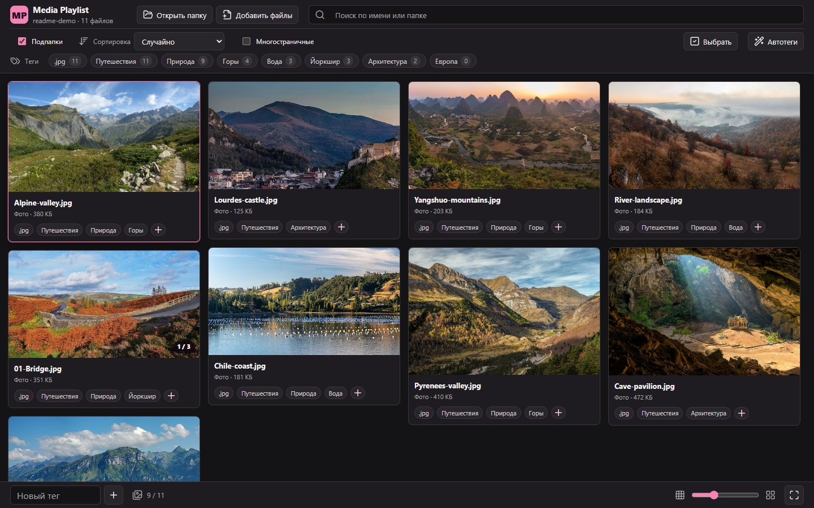
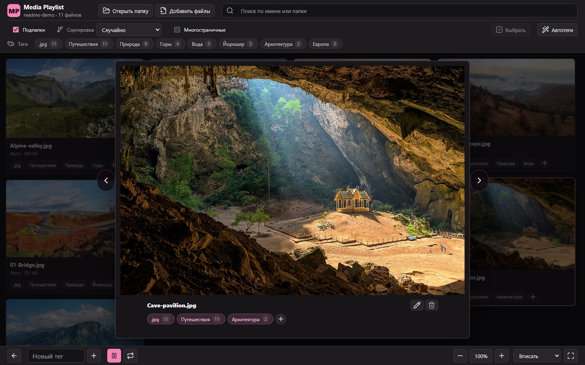
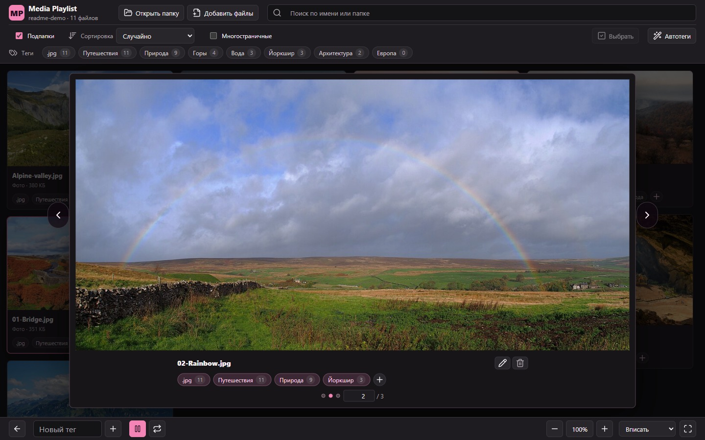
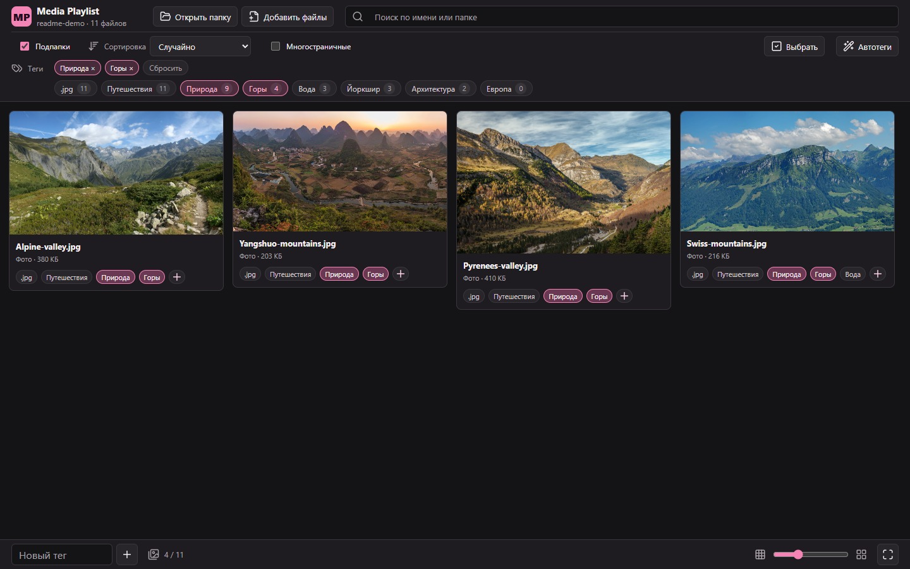
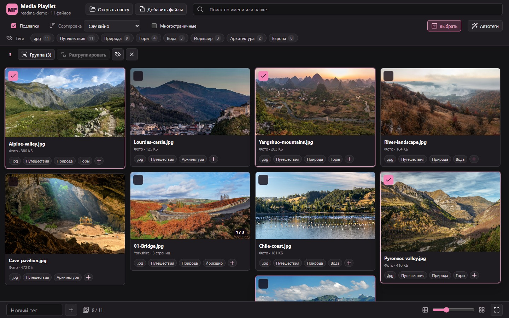
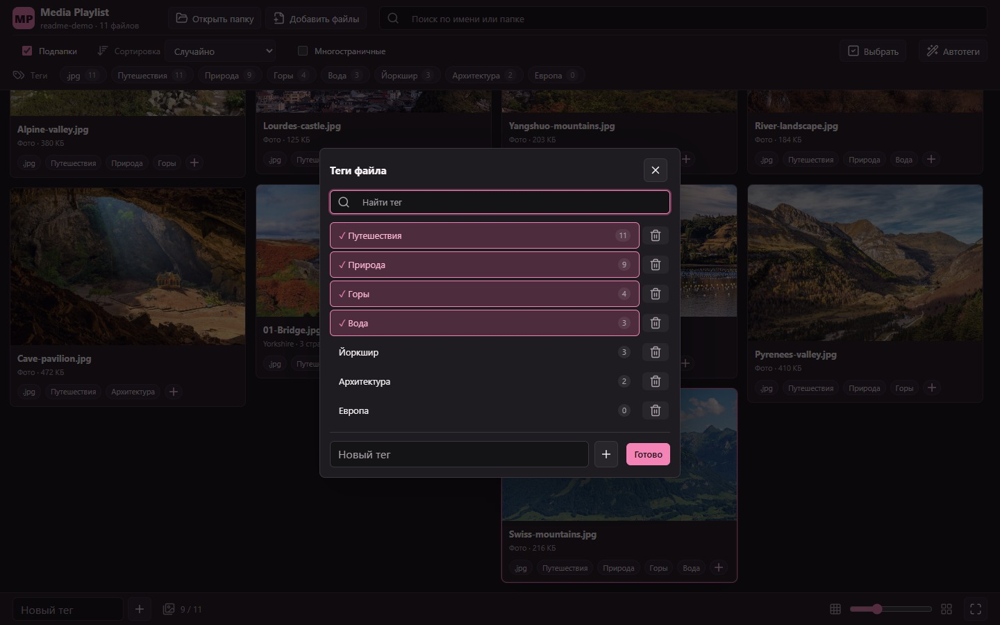
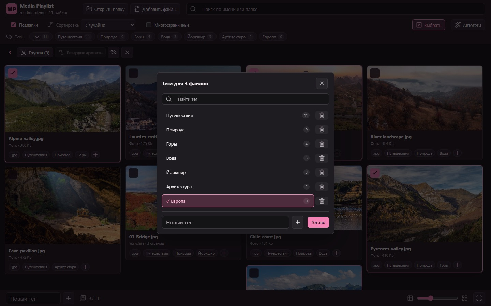
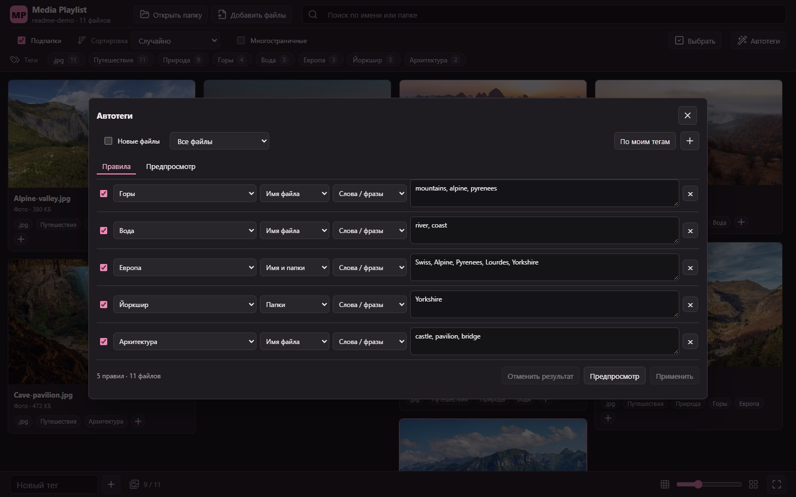
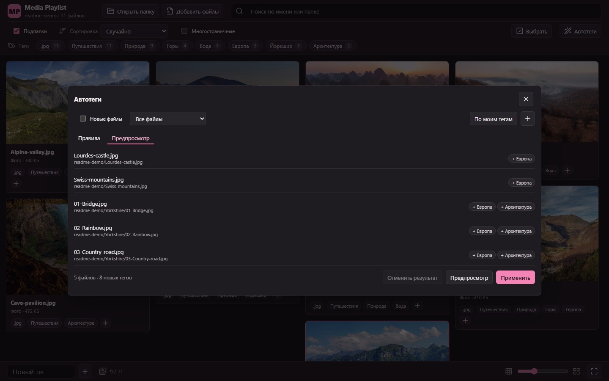
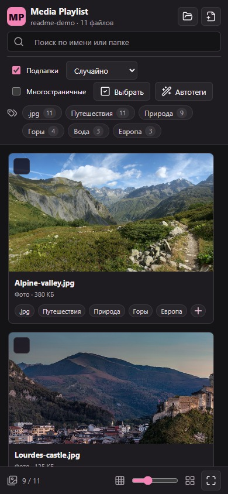

# MediaViewer

Локальный просмотрщик фото, видео, GIF и аудио в одной медиатеке. Работает в браузере без сервера, установки и интернета. Русский интерфейс, темная тема с розовым акцентом.



## Запуск

1. Скачайте **Code > Download ZIP** или клонируйте репозиторий:
   ```bash
   git clone https://github.com/awessine/MediaViewer.git
   ```
2. Откройте [MediaPlaylistViewer.html](app/MediaPlaylistViewer.html) в Chrome или Edge. В Windows можно использовать [Start-MediaPlaylistViewer.cmd](app/Start-MediaPlaylistViewer.cmd).
3. Нажмите **Открыть папку** или **Добавить файлы** и разрешите доступ по запросу браузера.

## Возможности

- **Коллекция.** Открытие папок с подпапками, добавление файлов без очистки коллекции, перетаскивание, запоминание последней папки и индикатор загрузки.
- **Плитка.** Раскладка по пропорциям изображений, регулируемые миниатюры и ленивая загрузка. Случайный порядок включен по умолчанию и не меняется при прокрутке или назначении тегов.
- **Поиск и сортировка.** Поиск по имени и пути, включая несколько слов; сортировка по имени, дате изменения, типу, размеру или случайно. Фильтр по всем выбранным тегам одновременно и отдельно по многостраничным элементам.
- **Подробный просмотр.** Окно поверх затемненной плитки с названием и тегами. Автовписывание, масштаб 25–500%, режимы «Вписать», «Заполнить», «Оригинал», прокрутка и полный экран. Перелистывание следует порядку плитки; возврат сохраняет позицию.
- **Воспроизведение.** Пауза и повтор видео, воспроизведение аудио. Видео можно запускать прямо в плитке, по одному за раз: щелчок по видео включает или останавливает его, по панели названия открывает подробный просмотр.
- **Теги.** Создание, назначение, снятие, удаление и поиск тегов через `+`. Новый тег сразу назначается текущему файлу или выбранным элементам; изменения в окне выбора применяются при его закрытии. Массовая разметка, счетчики файлов, сортировка по количеству и автоматические теги расширений.
- **Автотеги.** Правила по именам файлов и папок с ключевыми словами и синонимами. Совпадения по словам, фразам, части текста или точному имени с нормализацией регистра, разделителей и `е`/`ё`. Начальные правила создаются через «По моим тегам». Доступны обработка всей коллекции, выбора или текущего файла, предпросмотр, прогресс, остановка и отмена последнего применения. Ручные теги сохраняются; обработку новых файлов можно отключить.
- **Группы.** Ручная группировка и разгруппировка; подпапки автоматически становятся многостраничными карточками с общей разметкой. Обложка и страницы идут в порядке `1, 2, …, 10`. Стрелки листают только внутри группы; кружочки и поле номера позволяют выбрать страницу. Разгруппировка подпапки запоминается.
- **Файлы на диске.** Переименование с проверкой конфликтов и сохранением тегов и групп, удаление с подтверждением и обновлением состава группы. Клавиша `Delete` убирает файл только из коллекции.

**Важно:** удаление с диска выполняется без корзины и встроенной отмены. Для изменения файлов нужен доступ на запись. Если прямое переименование недоступно, файл копируется под новым именем и исходник удаляется после успешной записи; большие видео обрабатываются дольше.

## Скриншоты

Сняты в работающем приложении на 11 демонстрационных фотографиях с Wikimedia Commons. Личные файлы и теги не использовались. [Авторы и лицензии](docs/PHOTO-CREDITS.md).

<details>
<summary>Подробный просмотр и страницы группы</summary>





</details>

<details>
<summary>Фильтры, выбор файлов и теги</summary>









</details>

<details>
<summary>Правила автотегов и предпросмотр</summary>





</details>

<details>
<summary>Интерфейс в узком окне</summary>



</details>

## Форматы

| Тип | Расширения |
| --- | --- |
| Фото и анимации | `jpg`, `jpeg`, `png`, `gif`, `bmp`, `webp`, `avif`, `svg`, `ico` |
| Видео | `mp4`, `webm`, `ogv`, `mov`, `m4v`, `mkv`, `avi`, `wmv` |
| Аудио | `mp3`, `wav`, `ogg`, `oga`, `m4a`, `aac`, `flac`, `opus` |

Воспроизведение зависит от кодеков браузера; встроенного конвертера нет. `ogg` считается аудио, для видео Ogg используйте `ogv`.

## Клавиатура

| Клавиша | Действие |
| --- | --- |
| `←` / `→` | Файл или страница группы |
| `Пробел` | Пуск / пауза |
| `Esc` | Закрыть окно или вернуться в плитку |
| `F` / `F2` | Полный экран / переименование |
| `+` / `-` или `Ctrl` + колесо | Масштаб |
| `Delete` | Убрать из коллекции, не с диска |
| `Tab` / `Shift` + `Tab` | Переход между элементами |

При вводе текста команды просмотра не перехватываются.

## Данные и ограничения

- Медиафайлы не отправляются на сервер. Теги, группы, правила и размер миниатюр хранятся в `localStorage`, доступ к папке в `IndexedDB`; метаданные файлов не изменяются.
- Теги отдельных файлов привязаны к имени: одинаковые имена могут разделять разметку. Теги подпапки общие и привязаны к ее относительному пути; у ручной группы из разных папок разметка не объединяется. Счетчики считают файлы, а не карточки.
- Данные не синхронизируются между браузерами; очистка хранилища может удалить разметку. Экспорт и импорт пока отсутствуют. Случайный порядок и позиция сохраняются только в текущем сеансе.
- Запоминание папки и изменение файлов требуют разрешений и [File System Access API](https://developer.chrome.com/docs/capabilities/web-apis/file-system-access). Без него доступен обычный выбор папки.
- Карточки накапливаются при прокрутке; полной виртуализации и постоянного кэша миниатюр нет.
- Внешние переименования не отслеживаются, оригинальные имена не восстанавливаются. Нейросетевого распознавания, избранного, рейтингов, поиска дубликатов, сравнения, пакетного переименования и перемещения пока нет.
- Личные теги, правила, папки и исходные медиафайлы не входят в репозиторий. Скриншоты используют только демонстрационные данные; публичная копия не переносит разметку из другой локальной копии.

Код, стили и значки находятся в `app/MediaPlaylistViewer.html`; отдельная сборка не нужна.

## Лицензия

Код: [MIT](LICENSE). Значки Lucide: [ISC](app/Lucide-LICENSE.txt). Скриншоты: [CC BY-SA 4.0](https://creativecommons.org/licenses/by-sa/4.0/); фотографии сохраняют лицензии из [списка авторов](docs/PHOTO-CREDITS.md), а не MIT.
